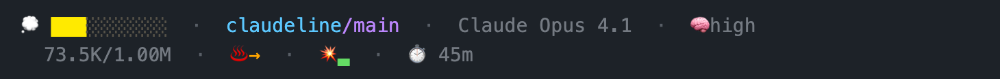

<div align="center">

<h1>claudeline</h1>

**A compact, informative status line for Claude Code with git, pace, and burst signals.**

[](LICENSE)
[](https://www.gnu.org/software/bash/)
[](https://claude.ai/)

</div>

```
🌱 ████░░░░░░  ·  myrepo/main*  ·  🔥↓  ·  💥▁
│  └────┬────┘     └─────┬─────┘   └┬─┘   └┬┘
│    context          repo/branch  pace   burst
│    bar              + git status trend
└─ context icon (✨🌱💭🧠🔥💾🫠💀)

    73.5K/200K  ·  Opus 5  ·  🧠high  ·  ⏱️ 45m
    └────┬────┘     └──┬──┘     └┬┘      └──┬──┘
      context        model     effort    duration
      tokens
```

<div align="center">

</div>

<hr>

<h2 align="center">📑 Contents</h2>

- [🚀 Quick Start](#quick-start)
- [✨ Features](#features)
- [📊 Smart Pace Indicator](#smart-pace-indicator)
- [💥 Burst Indicator](#burst-indicator)
- [💰 Spend Indicator](#spend-indicator)
- [⚡ Performance](#performance)
- [⚙️ Configuration](#configuration)
- [🔒 Privacy & Network Access](#privacy--network-access)
- [🔧 Requirements](#requirements)
- [🗑 Uninstall](#uninstall)

<hr>

<h2 align="center" id="quick-start">🚀 Quick Start</h2>

**One command:**

```bash
curl -fsSL https://raw.githubusercontent.com/scttbnsn/claudeline/main/install.sh | bash
```

> **Tip:** Review the [install script](install.sh) before running. The installer verifies SHA-256 checksums of all downloaded files before installing them.

Then restart Claude Code. That's it.

<details>
<summary>Optional: create a config file</summary>

Create `~/.claude/claudeline.conf` to customize without env vars:

```bash
# ~/.claude/claudeline.conf
theme=nord
segments=context,spend,git,pace,burst,duration,tokens,effort,model,stale
```

Env vars override config file values. All keys are optional.

Available keys: `theme`, `segments`, `no_color`, `debug`, `debug_log`, `trend_window`, `trend_history_max_age`, `spend`, `spend_icon`, `no_network`, `extra_usage_ttl`.

</details>

<details>
<summary>Manual installation</summary>

1. Download the runtime files:
   ```bash
   mkdir -p ~/.claude/lib
   curl -fsSL https://raw.githubusercontent.com/scttbnsn/claudeline/main/statusline.sh -o ~/.claude/statusline.sh
   curl -fsSL https://raw.githubusercontent.com/scttbnsn/claudeline/main/lib/statusline_themes.sh -o ~/.claude/lib/statusline_themes.sh
   curl -fsSL https://raw.githubusercontent.com/scttbnsn/claudeline/main/lib/statusline_display.sh -o ~/.claude/lib/statusline_display.sh
   curl -fsSL https://raw.githubusercontent.com/scttbnsn/claudeline/main/lib/statusline_usage.sh -o ~/.claude/lib/statusline_usage.sh
   chmod 700 ~/.claude/statusline.sh
   ```

2. Add to your `~/.claude/settings.json`:
   ```json
   {
     "statusLine": {
       "type": "command",
       "command": "~/.claude/statusline.sh",
       "padding": 0
     }
   }
   ```

3. Restart Claude Code

</details>

<hr>

<h2 align="center" id="features">✨ Features</h2>

<table>
<tr>
<td align="center" width="33%">
<h3>8-Tier Context Bar</h3>
Uses the context-window percentage Claude Code reports, scaled to the model's window (200K, or 1M on extended-context models), with color gradient and emoji icons
</td>
<td align="center" width="33%">
<h3>Smart Pace Indicator</h3>
Dual-signal weekly pace (burn rate + pressure) with 8-tier emoji scale and velocity-based trend arrows
</td>
<td align="center" width="33%">
<h3>Burst Indicator</h3>
8-level colored bar for 5-hour rate limit with reset countdown
</td>
</tr>
<tr>
<td align="center" width="33%">
<h3>Git Integration</h3>
Repo/branch with status indicators — unstaged, staged, ahead/behind, stash count
</td>
<td align="center" width="33%">
<h3>5 Built-in Themes</h3>
Vibey (default), Dark, Light, Nord, and Gruvbox — plus NO_COLOR support
</td>
<td align="center" width="33%">
<h3>Thinking Effort</h3>
Shows the active thinking tier with five distinct states: <code>🌱low</code>, <code>💭med</code>, <code>🧠high</code>, <code>⚡xhi</code>, <code>🔥max</code>
</td>
</tr>
</table>

<hr>

<h2 align="center" id="smart-pace-indicator">📊 Smart Pace Indicator</h2>

Compares your actual weekly usage against where you *should* be based on time elapsed in the 7-day rolling window.

**The math:** Two signals, take the worse one:
- **Burn rate** (velocity): `(pct / days_elapsed) × 7 / 100` — how fast you're going
- **Pressure** (position): `days_remaining / budget_remaining_in_days` — remaining runway

`effective = max(burn_rate, pressure)`

Both signals agree on over/under pace (`> 1.0` = over, `< 1.0` = under), but pressure amplifies urgency when budget is thin. For example, at 91% on Monday 8pm with reset Thursday 1pm: burn rate is 1.48 (🥵) but pressure is 4.29 — you have 9% left for 2.7 days (🚨).

Combined display: `👌→` (on pace, stable) or `🔥↑` (hot, getting hotter). At 100%, shows reset countdown: `🚨 -1.2d`.

<details>
<summary><strong>Pace emoji tiers</strong></summary>

| Effective Rate | Emoji | State |
|-------|-------|-------|
| < 0.3 | ❄️ | Way under pace |
| 0.3-0.6 | 🧊 | Under pace |
| 0.6-0.85 | 🙂 | Comfortable |
| 0.85-1.15 | 👌 | On pace |
| 1.15-1.4 | ♨️ | Warming |
| 1.4-1.8 | 🥵 | Hot |
| 1.8-2.5 | 🔥 | Very hot |
| ≥ 2.5 | 🚨 | Critical |

</details>

<details>
<summary><strong>Trend arrows</strong></summary>

Tracks **usage% velocity** — how fast you're burning tokens compared to the sustainable rate (100% / 7 days ≈ 0.01%/min).

| Velocity | Arrow | Meaning |
|----------|-------|---------|
| > 3x sustainable | ↑ | Heating fast |
| 1.5-3x sustainable | ↗ | Warming up |
| 0.5-1.5x sustainable | → | Stable |
| 0.1-0.5x sustainable | ↘ | Cooling down |
| < 0.1x sustainable | ↓ | Cooling fast |

**History retention:** Last 15 min dense (every ~30s), 15min–24h sparse anchors (1 per 4h), older pruned.

</details>

<hr>

<h2 align="center" id="burst-indicator">💥 Burst Indicator</h2>

**💥 Burst** (5-hour rate limit) — colored bar mapped directly to API utilization %, only shown when > 0%. Alternates to raw percent (`💥25%`) on its own 10-tick rotation cycle.

| Range | Bar | Color |
|-------|-----|-------|
| 1-12% | ▁ | cyan |
| 13-24% | ▂ | teal |
| 25-37% | ▃ | green |
| 38-49% | ▄ | yellow |
| 50-62% | ▅ | orange |
| 63-74% | ▆ | red |
| 75-87% | ▇ -135m | magenta + countdown |
| 88%+ | █ -90m | bright magenta + countdown |

A dimmed countdown shows minutes until the 5-hour window resets whenever usage is 75%+ *or* the reset is under an hour away.

<hr>

<h2 align="center" id="spend-indicator">💰 Spend Indicator</h2>

**Opt-in, off by default.** For enterprise usage-based seats — accounts with a monthly spend cap instead of (or alongside) the usual weekly/5-hour rate limits, where pace and burst have nothing to show. Renders as a bare percentage of the monthly cap used:

```
💰 68%
```

A null `monthly_limit` means unlimited, not zero — renders as `💰 ∞` since there's no percentage to show. A monthly budget is a different kind of signal than a 5-hour rate limit, so the percentage is colored using its own 11-tier scale — one color per 10%, eleven distinct colors ramping cyan through magenta to white-hot — rather than the burst indicator's scale, and appends 💀 once the spend limit is reached or usage hits 100% (e.g. `💰 103%💀`).

| Range | Color |
|-------|-------|
| 0-9% | cyan |
| 10-19% | teal |
| 20-39% | green |
| 40-59% | lime |
| 60-69% | yellow |
| 70-79% | orange |
| 80-89% | coral |
| 90-99% | red |
| 100%+ | magenta |

Enable it with `CLAUDELINE_SPEND=1` or `spend=1` in `claudeline.conf`. Most accounts don't have `extra_usage` at all, which is why this stays off unless asked for. The leading icon defaults to 💰 and can be changed with `CLAUDELINE_SPEND_ICON` or `spend_icon` in `claudeline.conf`.

<hr>

<h2 align="center" id="performance">⚡ Performance</h2>

| Scenario | Time |
|----------|------|
| Typical | ~30ms |

**Cost breakdown** (typical, ~30ms total):

| Phase | Time | Tool |
|-------|------|------|
| Git status | ~90ms | 3 git calls (parallelized with jq parse) |
| jq parse | ~16ms | 1 jq call |
| Trend/pace | ~20ms | 1 awk call |
| Formatting | ~22ms | 1 awk + bash math |
| Source libs + rest | ~27ms | bash |

Rate limit data comes directly from the Claude Code status line JSON — zero network calls by default. See [Privacy & Network Access](#privacy--network-access) for the one opt-in exception.

<details>
<summary><strong>Context bar tiers</strong></summary>

The bar maps the context-window percentage to 8 color/emoji tiers. Normally that's the percentage Claude Code reports directly; when you cap the auto-compact window below the model's physical window, the bar is measured against that cap instead (Claude Code's own percentage is relative to the full physical window), so the bar and the token count below it always agree:

| Range | Color | Icon | Meaning |
|-------|-------|------|---------|
| 0-14% | Cyan | ✨ | Fresh |
| 15-29% | Lime | 🌱 | Growing |
| 30-49% | Yellow | 💭 | Thinking |
| 50-64% | Orange | 🧠 | Working hard |
| 65-74% | Coral | 🔥 | Hot |
| 75-84% | Red | 💾 | Compact zone |
| 85-94% | Hot Pink | 🫠 | Past compact zone |
| 95%+ | Magenta | 💀 | Near hard wall |

The token count under the bar is measured against the effective window: the model's physical context size, or the auto-compact window when you cap it lower. Claudeline resolves that cap the same way Claude Code does, in this order:

1. The `CLAUDE_CODE_AUTO_COMPACT_WINDOW` env var.
2. The `autoCompactWindow` settings key, which is what `/config` → **Auto-compact window size** writes. Settings are merged across scopes in Claude Code's order (user → project → `.claude/settings.local.json` → managed), so the narrowest-scoped file wins.

Whichever is found is clamped to 100K–1M and then capped at the physical window. The `autoCompactWindow` setting is ignored when auto-compact is off (`autoCompactEnabled: false`, `DISABLE_AUTO_COMPACT`, or `DISABLE_COMPACT`); the env var applies either way, matching Claude Code. Claude Code also has server-driven per-model defaults that no status line can observe, so a window it picked on its own won't show up here.

</details>

<hr>

<h2 align="center" id="configuration">⚙️ Configuration</h2>

| Variable | Effect |
|----------|--------|
| `CLAUDELINE_THEME=nord` | Theme: `vibey` (default), `dark`, `light`, `nord`, `gruvbox` |
| `CLAUDELINE_SEGMENTS=context,git,pace` | Show only listed segments. Available: `context`, `spend`, `git`, `pace`, `burst`, `duration`, `tokens`, `effort`, `model`, `stale` |
| `NO_COLOR=1` | Disables all color output ([spec](https://no-color.org)) |
| `CLAUDELINE_DEBUG=1` | Enables debug logging to `$TMPDIR/claudeline-statusline-debug.log` |
| `CLAUDELINE_DEBUG_LOG=/path` | Custom debug log path (requires `CLAUDELINE_DEBUG=1`) |
| `TREND_WINDOW=900` | Trend arrow sample window in seconds (default: 900) |
| `TREND_HISTORY_MAX_AGE=86400` | Max age for trend history entries in seconds (default: 86400) |
| `CLAUDELINE_SPEND=1` | Opt in to the [spend indicator](#spend-indicator) (default: off) |
| `CLAUDELINE_SPEND_ICON=🪙` | Leading icon for the spend indicator (default: `💰`) |
| `CLAUDELINE_NO_NETWORK=1` | Hard kill switch — skips the spend fetch entirely, independent of `CLAUDELINE_SPEND` |
| `EXTRA_USAGE_TTL=600` | Spend cache TTL in seconds (default: 600) |

**Local data stored** in `~/.claude-usage.d/` (created with `chmod 700`):

| File | Purpose |
|------|---------|
| `.usage-history` | Rolling 24h usage samples for trend arrows |
| `.extra-usage-cache` | Cached spend segment fields (only written when `CLAUDELINE_SPEND=1`) |
| `.extra-usage-fetch.lock` | Lock directory guarding the background spend refresh against concurrent panes |

<hr>

<h2 align="center" id="privacy--network-access">🔒 Privacy & Network Access</h2>

By default claudeline makes **zero network calls**. Opting into the [spend indicator](#spend-indicator) (`CLAUDELINE_SPEND=1`) adds **one optional API call** to `https://api.anthropic.com/api/oauth/usage` — a `GET` request with only an `Authorization` header and no request body. Nothing else in claudeline touches the network.

The OAuth token is read **read-only**, never refreshed or written back — a refresh response can rotate the refresh token, and a second writer racing Claude Code's own refresh could log you out:
- **macOS:** the `Claude Code-credentials` entry in Keychain, via `security find-generic-password`
- **Fallback (all platforms):** `${CLAUDE_CONFIG_DIR:-~/.claude}/.credentials.json`

The fetch runs in a **non-blocking background subshell**, guarded by a lock file so concurrent panes don't stampede the endpoint, and is skipped entirely when the cached value is still fresh (`EXTRA_USAGE_TTL`, default 600s).

| Variable | Effect |
|----------|--------|
| `CLAUDELINE_SPEND=1` | Required to enable the spend fetch at all — off by default |
| `CLAUDELINE_NO_NETWORK=1` | Disables the spend fetch even when `CLAUDELINE_SPEND=1` is set |
| `CLAUDELINE_DEBUG=1` | Enables debug logging to `$TMPDIR/claudeline-statusline-debug.log` |

<hr>

<h2 align="center" id="requirements">🔧 Requirements</h2>

<div align="center">

[](https://jqlang.github.io/jq/)
[](https://git-scm.com/)
[](https://www.perl.org/)
[](https://curl.se/)

</div>

<hr>

<h2 align="center" id="uninstall">🗑 Uninstall</h2>

```bash
# Remove statusline files
rm -f ~/.claude/statusline.sh
rm -rf ~/.claude/lib/statusline_themes.sh ~/.claude/lib/statusline_display.sh ~/.claude/lib/statusline_usage.sh

# Remove the statusLine key from settings.json
jq 'del(.statusLine)' ~/.claude/settings.json > ~/.claude/settings.json.tmp && mv ~/.claude/settings.json.tmp ~/.claude/settings.json

# Remove cached data (optional)
rm -rf ~/.claude-usage.d
```

Then restart Claude Code.

---

<div align="center">

**[MIT License](LICENSE)**

</div>
